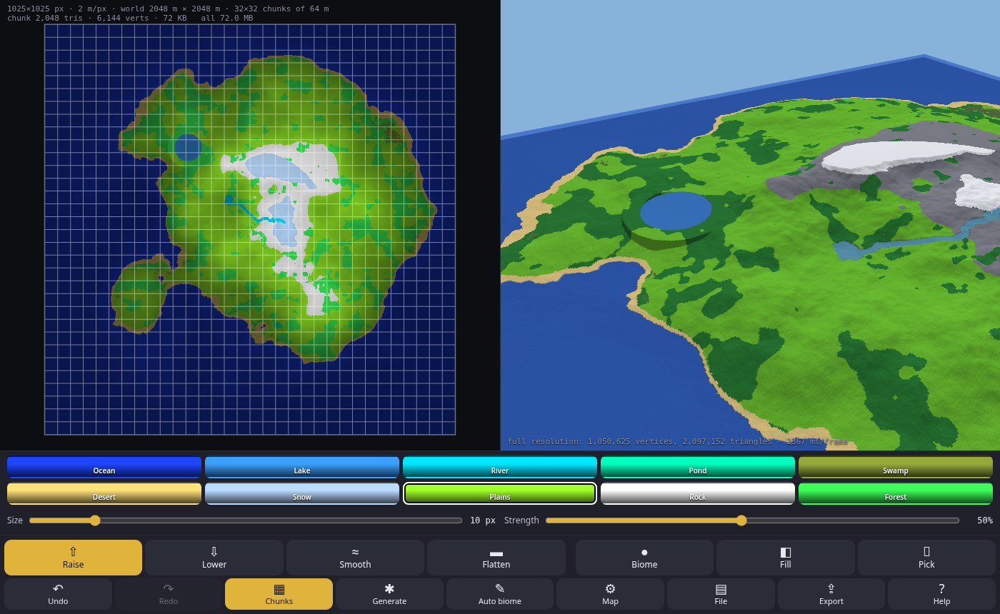

# Terrain Maker

A pixel drawing -> heightmap mesh, editor.

You paint a world map as **one color image** in a phone or desktop browser, see it in 3D at full resolution, and export it as a C header (or a binary file) for a game engine.

**Live:** https://nhsoule.github.io/Terrain_Maker/

## How the image works

Each pixel is one terrain vertex.

- **Hue = biome.** Each biome has a key color (the swatches). A pixel belongs to the biome whose key color has the closest hue (chromaticity `(r,g,b)/(r+g+b)`), however bright or dark the pixel is.
- **Brightness = height.** A biome's full key color is Max height. Darker shades are lower, down to 30% brightness at 0 m. It never goes black, so dark pixels keep a readable hue.
- The height is read from the channel sum: `height = ((r+g+b) / keySum - 0.3) / 0.7`. That gives about 250 to 535 height steps depending on the biome (0.5 m or finer at 120 m Max height).
- Pure black (`r+g+b < 12`, no hue) counts as Ocean at 0 m.

There are 10 biomes with contiguous ids 0..9, exported as `BIOME_OCEAN = 0` and so on. New biomes will only be added at the end. The packed format allows up to 16.

| Id | Biome | Key color (map, max height) | Game color (3D + export) | Water |
|---|---|---|---|---|
| 0 | Ocean  | `#1E46FF` (30, 70, 255)   | 58, 86, 120   | yes |
| 1 | Lake   | `#3CA0FF` (60, 160, 255)  | 76, 98, 110   | yes |
| 2 | River  | `#00E6FF` (0, 230, 255)   | 98, 104, 96   | yes |
| 3 | Pond   | `#00FFBE` (0, 255, 190)   | 74, 90, 64    | yes |
| 4 | Swamp  | `#96AA3C` (150, 170, 60)  | 78, 92, 52    | yes |
| 5 | Desert | `#FFE178` (255, 225, 120) | 226, 200, 130 | |
| 6 | Snow   | `#B9DCFF` (185, 220, 255), icy blue-white | 240, 244, 250 | |
| 7 | Plains (grassy) | `#A0FF28` (160, 255, 40) | 106, 190, 48 | |
| 8 | Rock   | `#FFFFFF` (255, 255, 255), grey/white | 128, 130, 140 | |
| 9 | Forest | `#3CFF5A` (60, 255, 90)  | 40, 122, 52   | |

The key colors are spread out by hue, so every brightness of a key still reads as its own biome. The closest pair is Snow and Rock, at a chroma distance of 0.075. Rounding moves a pixel at most 0.0065, so no two keys can be confused. A test checks every biome at every brightness.

For water biomes (0 to 4), the game color is the bed (sea floor, lake bottom, river bed).

### Water

A water biome's brightness is the height of its **bed**, like any other biome. The water surface on top is computed from these rules:

| Biome | Water surface |
|---|---|
| Ocean | **Sea level** (a Map setting). Auto biome makes everything below it Ocean. An Ocean pixel above sea level is dry. |
| Lake, Pond | Each connected patch (4-neighbor, same biome) fills up to its **spill level**: the lowest ground around its edge. An Ocean neighbor counts as at least sea level. The surface is at least 0.3 m above the patch's lowest bed. Bed above the surface is dry shore, so paint lakes lower than their banks. |
| River | **Bed + 0.8 m**, and it flows downhill. A priority flood runs upstream from the river's outlets (river pixels touching Ocean, Lake or Pond). Going upstream the surface never drops, so a dip in the bed becomes a calm pool instead of water running uphill. A river with no outlet starts from its lowest pixel. |
| Swamp | Wet ground with a **0.25 m** film of standing water over the bed. |

A sample is under water where `surface > bed`, and `depth = surface - bed`. The 3D view draws the surfaces see-through, tinted per water type (toggle in Map settings). The 2D hover shows the surface and depth.

### Older maps

Maps saved with an older palette are converted when you load them. That covers PNG metadata, the autosave and JSON projects. Each pixel is decoded with the old keys and re-encoded with the current ones, keeping its height.

| Saved as | Conversion |
|---|---|
| Version 3 (11 biomes) | Fall becomes Forest. Plains, Rock and Forest move from ids 8, 9, 10 to 7, 8, 9. Everything else keeps its id. |
| Version 2 or lower (7 biomes) | Water becomes Ocean, Sand becomes Desert, Grass becomes Plains, Dirt becomes Desert. Forest, Rock and Snow stay the same. |

PNGs without Terrain Maker metadata are read with the current palette.

## Use

- **Raise / Lower / Smooth / Flatten** change brightness and keep the hue.
- **Biome / Fill** change the hue and keep the brightness. **Pick** takes the biome under your finger.
- One finger or left mouse paints. Two fingers or right-drag pans; pinch or the wheel zooms. In 3D: drag to orbit, pinch or wheel to zoom.
- **Generate** makes a seeded island or continent. **Auto biome** colors the map from height and slope.
- **Map** sets the size, max height, sea level, chunk size and vertex size, and shows chunk and mesh stats.
  - **Width and height** in pixels, 16 to 4096 each (they can differ), and **meters per pixel**. Each pixel is a vertex, so the world is `(pixels - 1) * m/px` meters.
  - **Presets:** 1025 × 1025 px @ 2 m = 2048 m, which is exactly 32 × 32 chunks of 32 cells and is the default. There are also 2049 @ 1 m (2048 m), 1001 @ 2 m and 2001 @ 1 m (exactly 2000 m), 1024 @ 2 m (2046 m), 2000 @ 1 m (1999 m), 513 @ 4 m and 256 @ 2 m.
  - A live preview shows the new world size, chunk layout, data size and triangle count before you press **Apply size**. If `(size - 1)` doesn't divide by the chunk size, a hint names the nearest sizes that do. Uneven sizes still work, and the last chunk column or row is just narrower.
  - **Resizing keeps the painting** by *scaling* it (bilinear heights, nearest-pixel biomes) or by *cropping or padding* it 1:1, centered or from the NW corner. New area is sea floor. Undo restores the old size.
- **The 3D preview is full resolution:** one vertex per pixel, the exact grid you export, with no reduced detail. A 2000 × 2000 map is 8 million triangles, which a desktop GPU draws in a few ms. Very big maps can be slow on phones (the 3D corner shows a note and the measured ms per frame).
- **The 2D map is pixel-exact** (nearest-neighbor). Zoom in and a pixel grid appears, and brush size 1 paints exactly one pixel. **F** fits the map, **=** zooms to one screen pixel per map pixel.
- **File**:
  - **Save map PNG** saves the whole map. The settings ride along in a PNG text chunk.
  - **Open** takes a PNG, or an old v1 `.json` project, which is converted.
  - **Save palette PNG** gives you one color ramp per biome (0 m to Max height, in id order), to use in other paint apps.
  - **Import grey heightmap** replaces the heights and keeps the biomes.
  - Work also autosaves in the browser (IndexedDB, so 4096 × 4096 maps fit), and older autosaves are picked up on first load.
- **Export** writes `<name>.h` or `<name>.bin`, always at full resolution.

You can edit the PNG in any pixel editor. Keep it lossless (no JPEG, no smoothing). Off-palette colors snap to the nearest biome hue when the file is opened.

Keys:
- Ctrl+Z / Ctrl+Y: undo and redo
- `[` `]`: change brush size
- `1`-`9`, `0`: pick a biome in swatch order (`1` = Ocean ... `9` = Rock, `0` = Forest)
- `F`: fit the map
- `=`: 1:1 zoom (stays on `=` because `0` picks Forest)

## Export

Every export is the full map: one sample per pixel. Pick one of three data formats. Each format also includes a **water surface grid** at the same scale as the height.

| Format | Height + biome | Water surface | Per sample | Height levels | Data at 1025 × 1025 | Data at 2000 × 2000 |
|---|---|---|---|---|---|---|
| `uint16` height + `uint8` biome | 3 B | `uint16` | 5 B | 65536 | 5.0 MB | 19.1 MB |
| `uint8` height + `uint8` biome | 2 B | `uint8` | 3 B | 256 | 3.0 MB | 11.4 MB |
| **packed** `uint16` | 2 B | `uint16` (0..4095) | 4 B | 4096 (12 bits) | 4.0 MB | 15.3 MB |

**Packed:** height in the top 12 bits, biome in the low 4 bits, so `h = v >> 4` (0..4095) and `biome = v & 15`. That allows at most 16 biomes (there are 10). At 120 m Max height one step is about 3 cm.

Multiply any height or water value by `height_scale` to get meters. `height_scale` is `max_height / 65535`, `/ 255` or `/ 4095` depending on the format.

**Water:** `water[i]` is the water surface in height steps, or 0 where there's no water. A sample is wet when `water[i] > height`, and `depth = (water[i] - height) * height_scale`. Only water biomes are ever wet.

At 8-bit (0.47 m steps), very shallow water such as the 0.25 m swamp film can round away. Use the 16-bit or packed format if that matters.

### C header (`<name>.h`)

- **Constants:**
  - Map: `name_w`, `name_h`, `name_meters_per_px`, `name_max_height`, `name_height_scale`, `name_sea_level`
  - Chunks: `name_chunk_cells`, `name_chunks_x`, `name_chunks_y`
  - Format: `name_is_packed`, `name_has_water`
- **Shared tables** (behind the `TERRAIN_BIOMES_V4_DEFINED` guard):
  - `enum TerrainBiome`: `BIOME_OCEAN = 0`, `BIOME_LAKE`, `BIOME_RIVER`, `BIOME_POND`, `BIOME_SWAMP`, `BIOME_DESERT`, `BIOME_SNOW`, `BIOME_PLAINS`, `BIOME_ROCK`, `BIOME_FOREST = 9`, `BIOME_COUNT`
  - `terrain_biome_name` and `terrain_biome_is_water`
  - `terrain_biome_rgb` (game colors) and `terrain_biome_key_rgb` (map key colors)
  - `terrain_biome_water_rgba` (preview water tint)
  - `TERRAIN_KEY_MIN_BRIGHTNESS`
- **Data:**
  - Separate formats have `name_height[w*h]` (`uint16_t` or `uint8_t`) and `name_biome[w*h]` (`uint8_t`).
  - Packed has `name_packed[w*h]` (`uint16_t`).
  - All formats have `name_water[w*h]`, the same type as the height.

A 2000 × 2000 map makes a header of about 30 to 47 MB. It compiles, but for big maps `.bin` is the easier choice.

### Binary (`<name>.bin`, little-endian, version 2)

| Offset | Type | Field |
|---|---|---|
| 0 | char[4] | `"TMAP"` |
| 4 | u32 | version (2) |
| 8 | u32 | w |
| 12 | u32 | h |
| 16 | u32 | chunk_cells |
| 20 | u32 | chunks_x |
| 24 | u32 | chunks_y |
| 28 | u32 | format: 0 = u16 height + u8 biome, 1 = u8 height + u8 biome, 2 = packed u16 |
| 32 | f32 | meters_per_px |
| 36 | f32 | max_height |
| 40 | f32 | height_scale (meters per height or water step) |
| 44 | f32 | sea_level |
| 48 | u32 | biome count (N) |
| 52 | u32 | flags: bit 0 = water grid present |
| 56 | u32 | data offset (`64 + 32*N`) |
| 60 | u32 | water grid offset |
| 64 | 32 B × N | biome table, see below |
| data offset | | format 0: `u16 height[w*h]` then `u8 biome[w*h]`. Format 1: `u8 height[w*h]` then `u8 biome[w*h]`. Format 2: `u16 packed[w*h]`. |
| water offset | | `u16 water[w*h]` (formats 0 and 2) or `u8 water[w*h]` (format 1) |

Each biome table entry is 32 bytes:

| Bytes | Field |
|---|---|
| 0 | u8 id |
| 1 | u8 is_water |
| 2-4 | game rgb |
| 5-7 | key rgb |
| 8-11 | water rgba (alpha 0..255) |
| 12-31 | name, NUL padded |

So the file size is `64 + 32*N + w*h*5` for format 0, `64 + 32*N + w*h*3` for format 1, and `64 + 32*N + w*h*4` for format 2.

Version 1 files (before water) had no table and the data at 64. Read the offsets from the header rather than hard-coding them.

### Layout

- **Grid:** row-major (`i = row * w + col`), and row 0 is north. World `x = col * mpp`, `y = (h - 1 - row) * mpp`, `z = height * height_scale`. Each pixel is a vertex.
- **Cells:** there are `(w-1) × (h-1)` cells. Each cell makes two CCW triangles split on the SW-NE diagonal: SW-SE-NE and SW-NE-NW. A cell's biome is its NW sample's biome.
- **Chunks:** chunk `(cx, cy)` owns cells `col` in `[cx*C, min(cx*C + C, w-1))` and `row` in `[cy*C, min(cy*C + C, h-1))`. It reads samples up to `cx*C + C`, the edge it shares with its neighbor, so chunks never crack.
  - `chunks_x = ceil((w-1) / C)` and `chunks_y = ceil((h-1) / C)`. When `(w-1)` isn't a multiple of C, the last column is `(w-1) - (chunks_x-1)*C` cells wide, and the same goes for rows.
  - With 1025 px and C = 32, every chunk is full.

The comments in the header spell out the exact layout and how to decode the PNG yourself.

Everything is one `index.html`. There is no build step and nothing to install.
