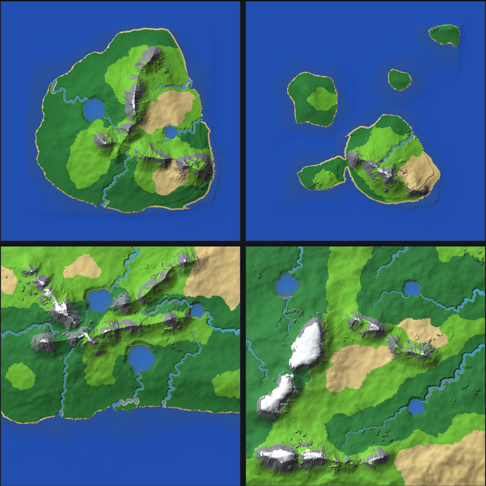
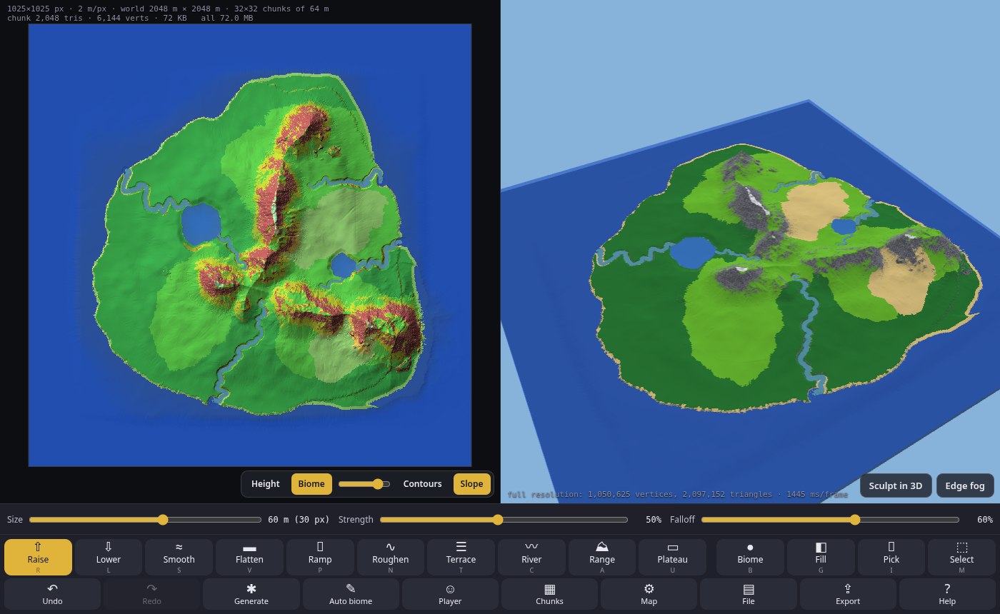

# Terrain Maker

A terrain editor for low-poly game worlds: generate a base, sculpt it, let it paint the biomes, walk it in first person, and export it as a C header or a binary file.


**Live:** https://nhsoule.github.io/Terrain_Maker/

Everything is one `index.html`. There is no build step and nothing to install. It works in desktop and phone browsers.

## Two layers

The map is two separate layers. Each pixel is one terrain vertex.

- **Height**: a float in meters per pixel, between **Min height** and **Max height** (Map settings, default 0 to 200 m, sea level 20 m). The sculpt tools only change this layer.
- **Biome**: one of 10 biomes per pixel (ids 0..9 below). The biome tools only change this layer.

The 2D view shows either layer (**H** toggles):
- **Height**: grey by height with hillshade (sun from the north-west).
- **Biome**: the biome colors over the same relief, with an opacity slider.
- **Contours** (**K**) draws a line every few meters (a round step for about 20 lines over the range), and every 5th line darker.
- **Slope** (**J**) tints the ground by how steep it is: green is walkable, yellow is close to the limit (75 % of it), red is too steep. The limit is **Steep slope** in Map settings (default 35°).

Hovering shows the height, biome, water depth, slope, pixel and world position.

| Id | Biome | Game color (3D + export) | Water |
|---|---|---|---|
| 0 | Ocean  | 58, 86, 120   | yes |
| 1 | Lake   | 76, 98, 110   | yes |
| 2 | River  | 98, 104, 96   | yes |
| 3 | Pond   | 74, 90, 64    | yes |
| 4 | Swamp  | 78, 92, 52    | yes |
| 5 | Desert | 226, 200, 130 | |
| 6 | Snow   | 240, 244, 250 | |
| 7 | Plains (grassy) | 106, 190, 48 | |
| 8 | Rock   | 128, 130, 140 | |
| 9 | Forest | 40, 122, 52   | |

New biomes will only be added at the end. The packed export format allows up to 16. For water biomes the game color is the bed.

## Workflow

1. **Generate** a world (or keep the island a new map starts with).
2. **Sculpt** the big moves with a large brush: add a mountain **Range**, raise a **Plateau**, raise or lower whole areas, **Flatten** build sites, **Ramp** roads between them, and carve **River** valleys to the sea. Finish with **Smooth**, **Roughen** or **Terrace**. Check walkability with the **Slope** view (**J**).
3. **Auto biome** paints climate regions (forest, grassland, desert, swamp, snow) plus rock on steep slopes. Re-run it after sculpting.
4. Touch up by hand with the **Biome** brush and **Fill**: lakes, ponds, a desert.
5. Walk it with **Player** at your game's eye height and FOV.
6. **Export**.

## Tools

The brush **Size** is in meters, and each tool remembers its own size. There is also **Strength**, and **Falloff** (0 = hard edge, 1 = very soft). A pen's pressure scales the strength. The map shows the brush outline and the falloff ring.

The tools work on the 2D map and on the 3D view. **Sculpt in 3D** (**E**) raycasts the brush onto the terrain. In that mode right drag orbits and middle or Shift drag pans.

**Sculpt (height layer)**

| Tool | Key | What it does |
|---|---|---|
| Raise | R | Pushes the ground up under the brush. |
| Lower | L | Pushes the ground down. |
| Smooth | S | Softens bumps and sharp edges. |
| Flatten | V | Levels to the height where the stroke starts, or to a typed height (tick **fixed**). **Alt+click** (long press on touch) samples the height. |
| Ramp | P | Drag a line to get an evenly graded road or ramp from the start height to the end height. Size is the road width, and Falloff is how far the embankment blends out. |
| Roughen | N | Adds natural bumps. The detail size is in meters. |
| Terrace | T | Turns slopes into flat shelves with steep steps. The step height is in meters. |
| River | C | Drag a path. It carves a U-shaped channel that always runs downhill (high end to low end, at least a 0.1% grade), lowers the banks, and paints the bed River. Size is the channel width, and there is a depth setting. |
| Range | A | Drag a path to raise a mountain range along it: a ridged crest with spurs, foothills on both sides and (optionally) a low walkable pass. Size is the width of the steep core; **Height** is the crest height above the ground (default 90 m). It uses the same shape as the generator, so it blends in. One undo step. |
| Plateau | U | Raises the ground under the brush to a flat top (the height where the stroke starts + **Lift**, default 12 m, or a typed height with **fixed**). It never lowers ground, and the falloff makes the escarpment. |

**Biome layer**

| Tool | Key | What it does |
|---|---|---|
| Biome brush | B | Paints the selected biome (keys `1`-`9`, `0`). |
| Fill | G | Fills a connected area of one biome. |
| Pick | I | Takes the biome under the cursor. **Alt+click** with the brush or Fill does the same. |
| Select | M | Paints a soft selection (Alt erases). **Generate** can blend into it, and **Auto biome** can be limited to it. |

**Auto biome** has two modes.

**Climate** (the default) paints biomes as large regions, the way climate does:
1. **Temperature** falls with height (and, if you set a latitude direction, toward one map edge).
2. **Moisture** comes from the wind: air picks up water over the sea and lakes and drops it as it climbs mountains, so the windward side is wet and the lee side is in a **rain shadow**. Being near water and some large-scale noise add to it.
3. A Whittaker-style table turns temperature and moisture into Snow (cold), Swamp (very wet, flat, low and by water), Forest (wet), Desert (hot and dry) or Plains (grassland).
4. **Region cleanup**: a majority filter at the **region size** (default 300 m) and merging of small patches, then wandering borders. So you get whole forests, grasslands and deserts, not speckles.
5. Then terrain: Rock on slopes ≥ the rock angle, Snow above the snow line, beaches (optional), and Desert for the sea floor and dry beds.

Settings: **wind direction** (where it blows from, default 270° = west), **moisture** (−1 dry … +1 wet), **region size**, **latitude** (none / colder north / colder south), **beaches**, plus the rock angle and snow line. The generator dialog has the same climate settings.

**Classic** is the old rule list, per pixel: below sea level Desert, slope ≥ the rock angle (36°) Rock, above the snow line Snow, near water a Desert beach, flat low wet ground Swamp patches, otherwise Forest patches over Plains.

In both modes the scope is the whole map, the selection, or only pixels you haven't painted by hand (so hand-painted biomes are kept). Hand-painted water can be kept.

## Generator

**Generate** takes a **seed** and a preset. It always makes the same map from the same seed and settings, on any device.



### World generator (default)

New maps use the **World** generator. It builds the land in layers, the way real land is shaped, instead of one noise field:

1. **Land shape and regions.** A coastline, then broad regions at three levels (lowland, plateau, highland) with soft escarpments between them.
2. **Mountain ranges.** 1–4 ranges along curved ridgelines, with a ridged crest, spurs, foothills on both sides and low **passes** you can walk over. Mountains only appear in the ranges, so most of the land is open.
3. **Detail by zone.** Rolling hills on open land, a few terraced rock **outcrops and small cliffs**, and sharp ridges only in the mountain cores.
4. **Erosion.** Water erosion cuts valleys (stronger in the mountains, gentle on the lowlands), then slope erosion settles anything steeper than the rock angle.
5. **Rivers and lakes.** Rivers start in the hills and flow downhill to the sea (or off the map edge), filling lakes in the basins on the way. They are painted River and Lake.
6. **Walkable by design.** Open land is kept under the steep-slope limit; only range cores, outcrops and cliffs are steep. In tests about 88–93 % of the land is walkable at 35°.

| Preset | Look |
|---|---|
| Island | Sea all round, 2 ranges (the default map is Island, seed 7) |
| Archipelago | A main island with a range, and several smaller islands |
| Continent | Coast on one side, 3 ranges, inland lakes |
| Highlands | All land: plateaus and high ranges with snow |

Sliders: **Mountain ranges** (count), **Mountain height**, **Roughness** (hills), **Rock outcrops / small cliffs**, **Erosion**, **Rivers**, **Lakes**, **Rough facets on cliffs**, plus the climate settings for Auto biome.

It runs in a Web Worker with a progress bar. At 1025 × 1025 it takes about 3–6 s (Archipelago 2.8 s, Island 4.2 s, Continent 5.3 s, Highlands 5.8 s, of which climate biomes are about 0.5 s) in a headless test browser; a desktop is usually faster.

### Classic generator

The old presets (Island, Continent, Mountains & valleys, Rolling hills) are kept under **Generator → Classic**: domain-warped fBm noise, masked ridged noise and hydraulic erosion, with **Feature size**, **Mountains**, **Warp**, **Erosion**, **Edges** and optional **Terraces**. It takes about 2 s.

**Only in selection** blends the new terrain into the selected area (both generators). **Auto biome after** paints the result. Undo brings the old map back.

## Water

| Water | How it works |
|---|---|
| Ocean | Automatic: ground below **Sea level** that connects to the map edge (or to painted Ocean) is sea, and its surface is at sea level. Sculpt the coast and the shoreline follows. Turn it off with **Auto ocean** in Map settings to paint Ocean by hand. |
| Lake, Pond | Paint the biome in a dip. Each connected patch fills to its **spill level**: the lowest ground around its edge, and at least 0.3 m above its lowest bed. A bed above that surface is dry shore. |
| River | The surface is the bed + 0.8 m, and it flows downhill. A priority flood runs upstream from the river's outlets (where it touches Ocean, Lake or Pond). The surface never drops going upstream, so a dip in the bed becomes a pool. The River tool carves the bed for you. |
| Swamp | Wet ground with a 0.25 m film of standing water. |

A sample is under water where `surface > bed`, and `depth = surface - bed`. The 3D view draws the surfaces see-through, tinted per water type.

## Files

**File** menu:
- **Save project** (`.tmproj`): both layers at full float precision plus all the settings. It is a compressed binary file.
- **Open project / old map** takes:
  - a `.tmproj`
  - a height or biome PNG
  - a plain greyscale heightmap
  - an older Terrain Maker map: a one-image PNG or a `.json` project. These are converted (see below).
- **Save height PNG**: a 16-bit greyscale PNG, black = Min height, white = Max height. The range is stored in the PNG, so it opens at the same heights (within 1/65535 of the range).
- **Save biome PNG**: an RGB PNG, one key color per biome (the swatch underline colors).
- **Import height PNG / Import biome PNG** replace one layer and keep the other. Images of another size are scaled: bilinear for height, nearest pixel for biomes. Any 8- or 16-bit grey or color PNG works for height, using its luminance.
- **Import .h / .bin** opens a game export to keep editing it (see [Importing game exports](#importing-game-exports-h--bin)). **Open** also accepts these files.
- **New flat map** starts a flat map.

Work autosaves in the browser (IndexedDB, so 4096 × 4096 maps fit).

### Importing game exports (`.h` / `.bin`)

Use **File → Import .h / .bin** or **Open**, or drop the file anywhere on the page. Both are read in all three formats (uint16 + uint8, uint8 + uint8, packed uint16).

What comes back:
- Size, m/px, height range, sea level and chunk cells.
- The heights, in meters: `z = v × range / maxQ + Min height`.
- The biomes. They are matched by name from the file's `enum TerrainBiome` / name table where possible, otherwise by id. Ids the app does not know become Plains (the toast says how many).

Notes:
- **`.bin`**: version 2, and version 1 (no biome table or water). The `.bin` does not store the Min height, so a small dialog asks for it. It defaults to 0; use your old Min height if it was below 0.
- **`.h`**: the current header and older ones:
  - with no `height_offset` (heights start at 0 m)
  - with 11 biomes (Fall becomes Forest)
  - with 7 biomes (Water → Ocean, Sand / Dirt → Desert, Grass → Plains, as for older maps)

  Values may be decimal or hex, and comments are skipped. Big headers (a 2000 × 2000 uint16 header is about 45 MB) are read in a background worker with a progress bar. In tests that took about 0.4–1 s of parsing, and 5–9 s with page work included.
- **Water is recomputed** from the biomes and heights, not read from the file. If the result differs from the file's water grid by more than 2 % of the wet samples, the toast says so.
- **8-bit files** only have 256 height steps. The toast shows the step size; smooth before sculpting fine detail.
- The import is a single undo step. A broken file (cut off, wrong magic or version, values out of range, missing arrays) shows an error, and the map stays as it was.

**Round trip.** Export → import → export gives the same height and biome data byte for byte, in every format, for both `.h` and `.bin`. The 2000 × 2000 (uneven chunks) `.h` and `.bin` files are fully identical. The exceptions are:
- **Water grid.** The first re-export of a map that was not imported can differ by a few samples (117 of 740k in the test), because water is rebuilt from the quantized heights. After that it stays the same.
- **Auto Ocean.** In older files, land biomes that sit below sea level and touch the ocean become Ocean, the same way as when editing.
- **Map name.** A `.h` keeps its `<name>` prefix. A `.bin` is named after the file.

**Older maps** (one color image, where hue = biome and brightness = height) are split into the two layers when you open them, including old autosaves. Heights keep their values (Min height becomes 0). Biomes are decoded with the palette the map was saved with:
- Version 3 Fall becomes Forest.
- Version 2 Water becomes Ocean, Sand and Dirt become Desert, and Grass becomes Plains.

## Map settings

- **Width and height** in pixels (16 to 4096 each, they can differ) and **meters per pixel**. Each pixel is a vertex, so the world is `(pixels - 1) * m/px` meters.
  - The default is 1025 × 1025 px @ 2 m = 2048 m, which is exactly 32 × 32 chunks of 32 cells.
  - Presets: 2049 @ 1 m, 1001 @ 2 m, 2001 @ 1 m, 1024 @ 2 m, 2000 @ 1 m, 513 @ 4 m and 256 @ 2 m.
  - Resizing keeps the map by scaling it or by cropping or padding it 1:1. Undo restores the old size.
- **Min / Max height**: the range the export spreads its height steps over. Keep it tight for finer steps.
- **Sea level**, **Auto ocean**, chunk size, vertex size, water preview.
- **Slopes**: **Steep slope** (default 35°) is the walkable limit used by the Slope view and first person. **First person can't climb steep slopes** (on by default). **Rough look on steep slopes** (on by default) shades steep ground in the 3D preview as broken rock (see below).
- First person and edge fog settings (below).

**The 3D preview is full resolution**: one vertex per pixel, the exact grid you export, with no reduced detail. **The 2D map is pixel-exact**. **F** fits it, and **=** zooms to one screen pixel per map pixel.

## Keys

| Keys | Action |
|---|---|
| R L S V P N T C | Raise, Lower, Smooth, Flatten, Ramp, Roughen, Terrace, River |
| A U | Range, Plateau |
| B G I M | Biome brush, Fill, Pick, Select |
| `1`-`9`, `0` | Pick a biome (`1` = Ocean ... `9` = Rock, `0` = Forest) |
| `[` `]` | Brush size |
| `,` `.` | Strength |
| Alt + click | Flatten: sample the height. Biome tools: pick. Select: erase. (On touch, long press.) |
| H | Height or biome view |
| K | Contours |
| J | Slope view |
| E | Sculpt in 3D |
| F, `=` | Fit the map, 1:1 zoom |
| Ctrl+Z, Ctrl+Y (Ctrl+Shift+Z) | Undo, redo |
| Esc | Cancel the stroke, close a dialog, leave first person |
| W A S D, Shift, Space | First person: move, sprint, jump |

Mouse and touch:
- **2D map:** the left mouse or one finger uses the tool. Right or middle drag pans and the wheel zooms. Two fingers pan and pinch-zoom.
- **3D view:** drag orbits, right drag pans and the wheel zooms. Two fingers pan and zoom.

## First person (Player)

Walk the map at your game's player scale, to judge whether it is big enough.


1. Press **Player**, then click or tap a spot on the 2D map or in the 3D view. The 3D view becomes the player's eyes, at full resolution.
2. Look around and walk:
   - **Desktop:** click the 3D view to capture the mouse for mouse-look (dragging also works). `WASD` or the arrows move, `Shift` sprints, `Space` jumps.
   - **Touch:** your left thumb is a joystick (push it all the way to sprint). Drag on the right half to look. There is a **Jump** button.
3. **Esc** or the **Exit first person** button (top right) goes back to the orbit view. **Player** again lets you pick a new spot.

While you walk:
- **The readout** (top left) shows your position in meters and pixels, the chunk you are in, the ground height and eye height, the biome, any water depth, the distance to the nearest map edge and which edge it is, your compass facing, and the vertical and horizontal FOV.
- **On the 2D map,** a red dot with your view cone follows you, as it does on the small map in the corner. You can keep sculpting on the 2D map, and the view updates live.
- **Chunks on** draws chunk lines on the ground.
- **Movement:**
  - Your feet follow the exact exported mesh, using the same two triangles per cell.
  - The map edge is a wall.
  - Walking off a ledge drops you with gravity.
- **Steep slopes:** with **First person can't climb steep slopes** on, you can't walk up ground steeper than the Steep slope limit (35°); you slide along it instead, and the readout says "too steep". Walking down is fine, and jumping doesn't get you over it. The readout always shows the slope under you.
- **Water:**
  - You wade until the water is deeper than eye height − 0.3 m.
  - Past that, you swim with your eyes 0.3 m above the surface, at half speed.

**Map settings → First person** (saved with the project):

| Setting | Default | Notes |
|---|---|---|
| Eye height | 1.7 m | above the feet |
| Vertical FOV | 70° | the horizontal equivalent is shown for the 3D view's current shape, 16:9 and 4:3 (70° v = 102° h at 16:9) |
| Walk speed | 5 m/s | |
| Sprint multiplier | 2× | Shift, or a fully pushed joystick |
| Near clip | 0.1 m | |
| Far clip | 0 = auto | auto is the map's corner-to-corner distance (3094 m for 2048 m), so the whole map is always in view |

## Edge fog

The **Edge fog** button in the 3D view (also in **Map settings**, off by default) fades the terrain and water into a light haze toward the map boundary. That way you don't see a hard edge where the map ends.
- The fog grows over the last **Fog width** meters (150 m by default), based on each point's distance to the nearest map edge.
- It stays a little lighter close to you.
- Beyond the edge, and below the horizon, there is a haze backdrop instead of empty sky.
- It works in the orbit view and in first person.
- It is preview only. It is not exported.

## Rough look on steep slopes



Two separate things make cliffs read as rock:
- **Preview shading** (Map settings → **Rough look on steep slopes**, on by default). In the 3D view, land steeper than about the Steep slope limit is tinted rock color and each triangle's lighting is jittered, so it looks like broken, faceted stone. It is **preview only and is not exported**. For rock in the game, use the Rock biome: Auto biome paints it on slopes over the rock angle.
- **Height facets** (generator → **Rough facets on cliffs**, on by default). The World generator adds a small random height jitter (about 1–2 m at 2 m/px) on faces steeper than about 30°. This is real height, so it is exported.

## Export

Every export is the full map: one sample per pixel. Pick one of three data formats. Each format also includes a **water surface grid** at the same scale as the height.

| Format | Height + biome | Water surface | Per sample | Height levels | Data at 1025 × 1025 | Data at 2000 × 2000 |
|---|---|---|---|---|---|---|
| `uint16` height + `uint8` biome | 3 B | `uint16` | 5 B | 65536 | 5.0 MB | 19.1 MB |
| `uint8` height + `uint8` biome | 2 B | `uint8` | 3 B | 256 | 3.0 MB | 11.4 MB |
| **packed** `uint16` | 2 B | `uint16` (0..4095) | 4 B | 4096 (12 bits) | 4.0 MB | 15.3 MB |

**Packed:** height in the top 12 bits, biome in the low 4 bits, so `h = v >> 4` (0..4095) and `biome = v & 15`. That allows at most 16 biomes (there are 10). With the default 0 to 200 m range one step is about 5 cm.

To get meters, multiply any height or water value by `height_scale`, then add `height_offset`:

```c
world_z = height * height_scale + height_offset
```

- `height_offset` is the Min height. It is 0 unless you set a Min height below 0.
- `max_height` is the height range above the offset (Max − Min).
- `sea_level` is measured above the offset too.
- `height_scale` is `max_height / 65535`, `/ 255` or `/ 4095` depending on the format.

**Water:** `water[i]` is the water surface in height steps, or 0 where there's no water. A sample is wet when `water[i] > height`, and `depth = (water[i] - height) * height_scale`. Only water biomes are ever wet.

At 8-bit (0.78 m steps over 0 to 200 m), shallow water can round away: the 0.25 m swamp film, and in places the 0.8 m river. Use the 16-bit or packed format if that matters.

### C header (`<name>.h`)

- **Constants:**
  - Map: `name_w`, `name_h`, `name_meters_per_px`, `name_max_height`, `name_height_offset`, `name_height_scale`, `name_sea_level`
  - Chunks: `name_chunk_cells`, `name_chunks_x`, `name_chunks_y`
  - Format: `name_is_packed`, `name_has_water`
- **Shared tables** (behind the `TERRAIN_BIOMES_V4_DEFINED` guard):
  - `enum TerrainBiome`: `BIOME_OCEAN = 0`, `BIOME_LAKE`, `BIOME_RIVER`, `BIOME_POND`, `BIOME_SWAMP`, `BIOME_DESERT`, `BIOME_SNOW`, `BIOME_PLAINS`, `BIOME_ROCK`, `BIOME_FOREST = 9`, `BIOME_COUNT`
  - `terrain_biome_name` and `terrain_biome_is_water`
  - `terrain_biome_rgb` (game colors) and `terrain_biome_key_rgb` (biome PNG key colors)
  - `terrain_biome_water_rgba` (preview water tint)
  - `TERRAIN_KEY_MIN_BRIGHTNESS` (only for decoding old one-image maps)
- **Data:**
  - Separate formats have `name_height[w*h]` (`uint16_t` or `uint8_t`) and `name_biome[w*h]` (`uint8_t`).
  - Packed has `name_packed[w*h]` (`uint16_t`).
  - All formats have `name_water[w*h]`, the same type as the height.

A 2000 × 2000 map makes a header of about 30 to 47 MB. It compiles, but for big maps `.bin` is the easier choice.

### Binary (`<name>.bin`, little-endian, version 2)

| Offset | Type | Field |
|---|---|---|
| 0 | char[4] | `"TMAP"` |
| 4 | u32 | version (2) |
| 8 | u32 | w |
| 12 | u32 | h |
| 16 | u32 | chunk_cells |
| 20 | u32 | chunks_x |
| 24 | u32 | chunks_y |
| 28 | u32 | format: 0 = u16 height + u8 biome, 1 = u8 height + u8 biome, 2 = packed u16 |
| 32 | f32 | meters_per_px |
| 36 | f32 | max_height (height range: Max − Min height) |
| 40 | f32 | height_scale (meters per height or water step) |
| 44 | f32 | sea_level (above Min height) |
| 48 | u32 | biome count (N) |
| 52 | u32 | flags: bit 0 = water grid present |
| 56 | u32 | data offset (`64 + 32*N`) |
| 60 | u32 | water grid offset |
| 64 | 32 B × N | biome table, see below |
| data offset | | format 0: `u16 height[w*h]` then `u8 biome[w*h]`. Format 1: `u8 height[w*h]` then `u8 biome[w*h]`. Format 2: `u16 packed[w*h]`. |
| water offset | | `u16 water[w*h]` (formats 0 and 2) or `u8 water[w*h]` (format 1) |

Each biome table entry is 32 bytes:

| Bytes | Field |
|---|---|
| 0 | u8 id |
| 1 | u8 is_water |
| 2-4 | game rgb |
| 5-7 | key rgb |
| 8-11 | water rgba (alpha 0..255) |
| 12-31 | name, NUL padded |

So the file size is `64 + 32*N + w*h*5` for format 0, `64 + 32*N + w*h*3` for format 1, and `64 + 32*N + w*h*4` for format 2.

Version 1 files (before water) had no table and the data at 64. Read the offsets from the header rather than hard-coding them.

### Layout

- **Grid:** row-major (`i = row * w + col`), and row 0 is north. World `x = col * mpp`, `y = (h - 1 - row) * mpp`, `z = height * height_scale + height_offset`. Each pixel is a vertex.
- **Cells:** there are `(w-1) × (h-1)` cells. Each cell makes two CCW triangles split on the SW-NE diagonal: SW-SE-NE and SW-NE-NW. A cell's biome is its NW sample's biome.
- **Chunks:** chunk `(cx, cy)` owns cells `col` in `[cx*C, min(cx*C + C, w-1))` and `row` in `[cy*C, min(cy*C + C, h-1))`. It reads samples up to `cx*C + C`, the edge it shares with its neighbor, so chunks never crack.
  - `chunks_x = ceil((w-1) / C)` and `chunks_y = ceil((h-1) / C)`. When `(w-1)` isn't a multiple of C, the last column is `(w-1) - (chunks_x-1)*C` cells wide, and the same goes for rows.
  - With 1025 px and C = 32, every chunk is full.

The comments in the header spell out the exact layout.

The `.bin` header has no `height_offset` field (the layout is unchanged). If you set a Min height below 0, add it yourself, or read `height_offset` from the `.h`. The Export dialog reminds you when it isn't 0.

Everything is one `index.html`. There is no build step and nothing to install.
